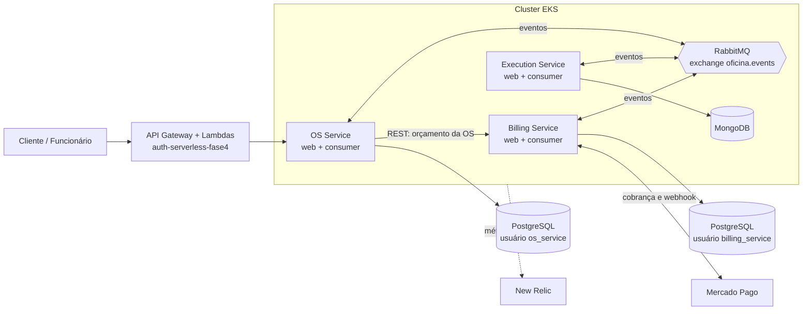
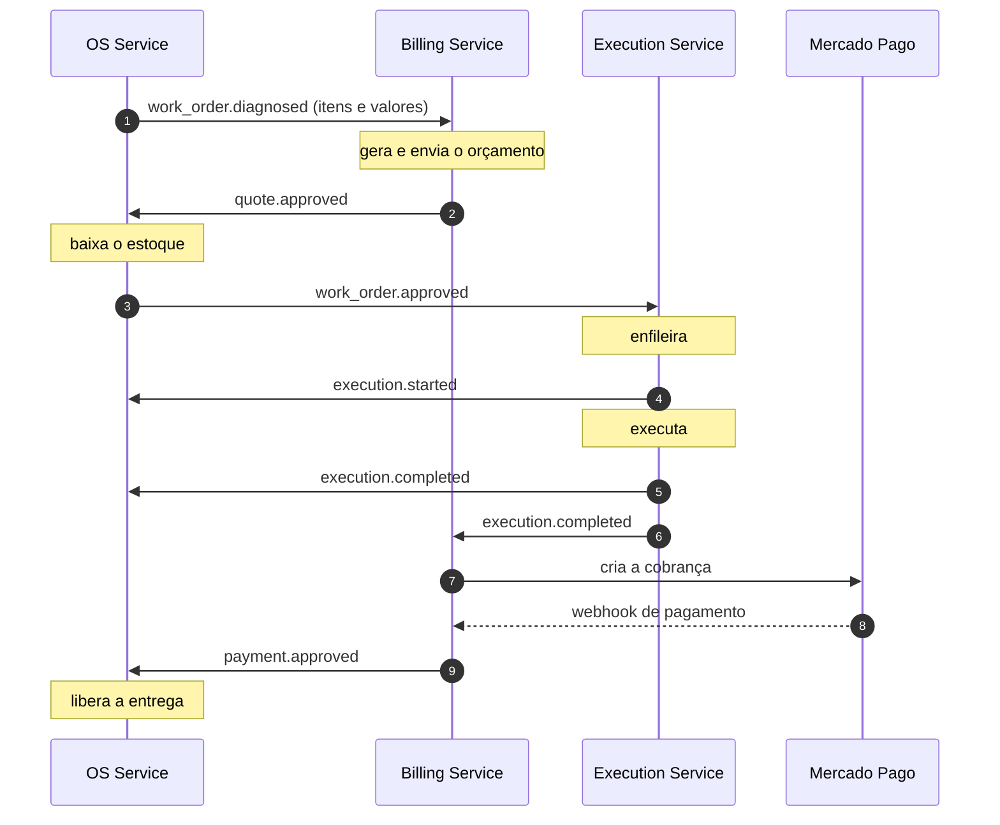

# OS Service — 15SOAT - Fase 4 - Tech Challenge - Grupo 161

Microsserviço de **Ordens de Serviço** da Oficina Mecânica. Na Fase 4 o monolito da Fase 3 foi dividido em três microsserviços que se comunicam por eventos, com o fluxo da OS coordenado por uma **Saga coreografada**. Este repositório é o ponto de partida do fluxo: cadastros, estoque, abertura, diagnóstico, status e entrega da OS.

> Fases anteriores: [Fase 1](docs/fase1/README.md) (DDD), [Fase 2](docs/fase2/README.md) (Kubernetes, Terraform, HPA), [Fase 3](docs/fase3/README.md) (autenticação por CPF, RBAC, serverless).

## Repositórios da Fase 4

| Repositório | Responsabilidade | Banco |
| :--- | :--- | :--- |
| [`os-service`](https://github.com/FIAP-15SOAT-GabrielHelton/os-service) (este) | Clientes, veículos, serviços, estoque, usuários e o ciclo de vida da OS | PostgreSQL |
| [`billing-service`](https://github.com/FIAP-15SOAT-GabrielHelton/billing-service) | Orçamento, aprovação e pagamento (Mercado Pago) | PostgreSQL |
| [`execution-service`](https://github.com/FIAP-15SOAT-GabrielHelton/execution-service) | Fila e andamento da execução | MongoDB |
| [`k8s-infra-fase4`](https://github.com/FIAP-15SOAT-GabrielHelton/k8s-infra-fase4) | VPC, EKS, RabbitMQ, MongoDB e New Relic | — |
| [`db-infra-fase4`](https://github.com/FIAP-15SOAT-GabrielHelton/db-infra-fase4) | RDS PostgreSQL, com um usuário e bancos isolados por serviço | — |
| [`auth-serverless-fase4`](https://github.com/FIAP-15SOAT-GabrielHelton/auth-serverless-fase4) | API Gateway e Lambdas de autenticação | — |
| [`deploy-orchestrator-fase4`](https://github.com/FIAP-15SOAT-GabrielHelton/deploy-orchestrator-fase4) | Deploy e destroy de todos os repositórios, em sequência | — |

## Arquitetura



- **Assíncrono:** os serviços trocam eventos por um exchange de tópico no RabbitMQ; cada serviço tem a sua fila durável.
- **Síncrono (REST):** só uma chamada entre serviços — o detalhe da OS busca o orçamento no Billing (API Composition), repassando o token do usuário. Se o Billing estiver fora, a OS responde sem o orçamento.
- **Bancos isolados:** nenhum serviço acessa o banco de outro. OS e Billing dividem a instância RDS, mas cada um tem usuário próprio e não consegue conectar nos bancos do outro; o Execution usa MongoDB.

## Saga

A Saga é **coreografada**: não há orquestrador central, cada serviço reage aos eventos dos outros e publica os seus.

**Por que coreografada:** são três serviços e um fluxo linear. Um orquestrador seria um quarto componente para desenvolver, implantar e manter, e um ponto único de falha, sem ganho real nesse tamanho. O custo conhecido da coreografia — o fluxo fica espalhado pelos serviços — é compensado pela documentação abaixo e pelo teste BDD, que percorre o fluxo inteiro.



### Compensações

| Falha | Evento | O que é desfeito |
| :--- | :--- | :--- |
| Cliente rejeita o orçamento | `quote.rejected` (Billing) | A OS é marcada como rejeitada |
| Estoque insuficiente na aprovação | `work_order.cancelled` (OS) | A OS é cancelada em vez de aprovada; o Billing cancela o orçamento; a execução não é criada |
| Execução falha | `execution.failed` (Execution) → `work_order.cancelled` (OS) | A OS é cancelada e as peças voltam ao estoque; o Billing cancela o orçamento |
| Pagamento não aprovado | — | Nada a desfazer: a OS segue aguardando pagamento e o cliente tenta de novo |

O pagamento acontece **na entrega**, depois da execução. Assim, uma falha na execução nunca exige estorno em dinheiro.

### Eventos deste serviço

| Publica | Quando |
| :--- | :--- |
| `work_order.diagnosed` | O diagnóstico é concluído (OS aguardando aprovação) |
| `work_order.approved` | O orçamento foi aprovado e o estoque baixado |
| `work_order.cancelled` | A OS é cancelada (estoque insuficiente ou falha na execução) |

| Consome | Reação |
| :--- | :--- |
| `quote.approved` | Baixa o estoque e aprova a OS (ou cancela, se faltar peça) |
| `quote.rejected` | Marca a OS como rejeitada |
| `execution.started` | OS em execução |
| `execution.completed` | OS concluída, aguardando pagamento |
| `execution.failed` | Cancela a OS e devolve as peças |
| `payment.approved` | OS paga, liberada para entrega |

Status da OS: `received → diagnosing → awaiting_approval → approved → in_progress → completed (aguardando pagamento) → paid → delivered`, com as saídas `rejected` e `cancelled`.

Decisões e alternativas avaliadas: [RFC-005](docs/fase4/RFC-005-microsservicos-e-saga.md).

## Execução local

Só o Docker é necessário:

```bash
cp .env.example .env
docker compose up -d --wait db rabbitmq
docker compose run --rm web bin/rails db:prepare
docker compose up web consumer
```

A API sobe em `http://localhost:3000`. O serviço `consumer` (`bin/consumer`) é o processo que escuta os eventos da Saga. Usuário de desenvolvimento: `admin@oficina.local` / `oficina123`.

Para o fluxo completo, suba também o `billing-service` (porta 3001) e o `execution-service` (porta 3002), apontando os três para o mesmo RabbitMQ.

## Documentação da API

- Swagger UI: `http://localhost:3000/api-docs` (ou `http://<endereço-do-serviço>/api-docs` no ambiente implantado).
- Spec OpenAPI versionada: [`swagger/v1/swagger.json`](swagger/v1/swagger.json).

## Testes e qualidade

```bash
docker compose run --rm -e RAILS_ENV=test web bundle exec rspec
```

- **Unitários e de integração:** RSpec, com cobertura mínima de 80% exigida pelo SimpleCov (hoje acima de 95%).
- **BDD:** o fluxo completo da OS está descrito em Gherkin em [`spec/features/fluxo_da_ordem_de_servico.feature`](spec/features/fluxo_da_ordem_de_servico.feature) — da abertura à entrega com pagamento aprovado, e a compensação quando a execução falha.
- **SonarQube Cloud:** [painel do projeto](https://sonarcloud.io/project/overview?id=FIAP-15SOAT-GabrielHelton_os-service), com quality gate no CI.

## CI/CD

- **CI** ([`ci.yml`](.github/workflows/ci.yml)): a cada PR, roda RuboCop, os testes e a análise do SonarQube. A `main` é protegida: só recebe código por PR com `lint` e `test` verdes.
- **CD** ([`cd_deploy.yml`](.github/workflows/cd_deploy.yml)): cria o repositório de imagens (Terraform), publica a imagem e implanta no EKS — migrations, `web`, `jobs`, `consumer`, Service e HPA (manifests em [`k8s/`](k8s/)). É disparado manualmente porque as credenciais da AWS Academy são temporárias; o [`deploy-orchestrator-fase4`](https://github.com/FIAP-15SOAT-GabrielHelton/deploy-orchestrator-fase4) dispara todos os repositórios na ordem certa.

## Observabilidade

New Relic, mantido da Fase 3: APM com rastreamento distribuído entre os três serviços e métricas do cluster. A configuração do agente está em [`config/newrelic.yml`](config/newrelic.yml); o dashboard e os alertas são criados pelo `k8s-infra-fase4`.

## Limitações conhecidas

- A publicação de eventos é best-effort após o commit: se o RabbitMQ estiver fora no momento, o evento se perde. O próximo passo seria um transactional outbox.
- RabbitMQ e MongoDB rodam no cluster sem volume persistente; servem ao ambiente efêmero da AWS Academy.
