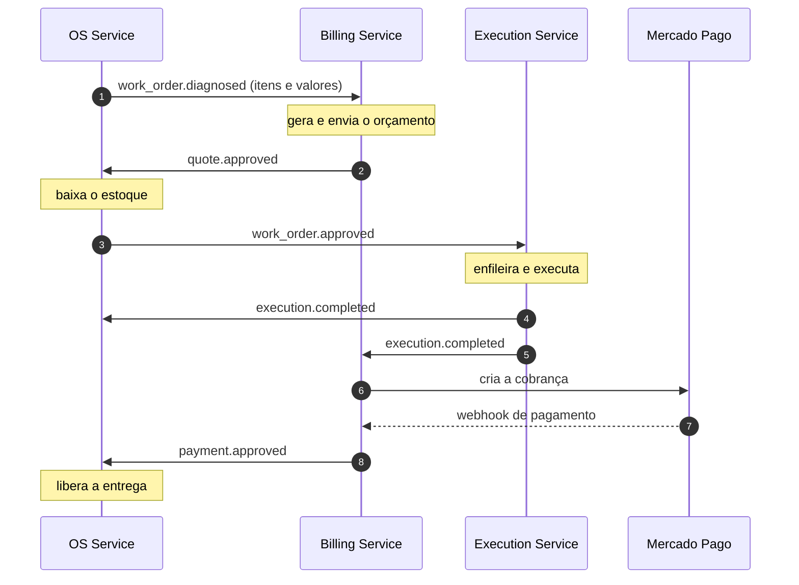

# RFC-005: Divisão em Microsserviços e Saga Pattern

| Metadado | Detalhe |
| :--- | :--- |
| **Título** | Divisão do monolito em 3 microsserviços com Saga coreografada |
| **Status** | `PROPOSTO` |
| **Autor(es)** | FIAP 15SOAT - Grupo 161 |
| **Data** | 12 de Novembro de 2026 |
| **Contexto** | Tech Challenge - Fase 4 (microsserviços, Saga Pattern, CI/CD por serviço) |
| **Repositórios afetados** | `api` (vira `os-service`), `billing-service` (novo), `execution-service` (novo), `k8s-infra`, `db-infra`, `deploy-orchestrator` |

---

## 1. Resumo

O monolito `api` é dividido em três serviços, cada um com repositório, banco e pipeline próprios. Eles se comunicam por eventos no RabbitMQ, e o fluxo da ordem de serviço é coordenado por uma Saga coreografada. Nenhum serviço acessa o banco de outro.

## 2. Divisão dos serviços

| Serviço | Banco | Responsabilidade | Origem no monolito |
| :--- | :--- | :--- | :--- |
| **OS Service** | PostgreSQL | Clientes, veículos, serviços, estoque, usuários, abertura e diagnóstico da OS, status, acompanhamento por protocolo, entrega | `registrations`, `inventory`, `accounts`, parte de `work_orders` |
| **Billing Service** | PostgreSQL | Orçamento, aprovação ou rejeição, cobrança via Mercado Pago | `quotes` + pagamento (novo) |
| **Execution Service** | MongoDB | Fila de execução, atribuição de mecânico, início e fim de cada item, conclusão | `assign`, `execute`, `start/finish_line_item`, `complete`, `ready_to_execute` |

A divisão segue os contextos que o monolito já separava em pastas (`app/domains/*`), o que reduz o trabalho a mover código em vez de reescrever. O estoque fica no OS Service para não criar um quarto serviço.

## 3. Saga

### Compensações

| Falha | Evento | Compensação |
| :--- | :--- | :--- |
| Cliente rejeita o orçamento | `quote.rejected` (Billing) | OS marca a ordem como rejeitada |
| Estoque insuficiente na aprovação | `work_order.cancelled` (OS) | Billing cancela o orçamento aprovado |
| Execução falha | `execution.failed` (Execution) | OS cancela a ordem e devolve as peças ao estoque; Billing cancela o orçamento |
| Pagamento falha | — | Nada a desfazer: a OS permanece aguardando pagamento e o cliente tenta de novo |

## 4. Decisões

| Decisão | Escolha | Motivo |
| :--- | :--- | :--- |
| Linguagem | Rails nos três serviços | Reaproveita código, testes, Dockerfile, manifestos e pipeline do `api` |
| Bancos | PostgreSQL (OS, Billing) e MongoDB (Execution) | Cumpre a exigência de SQL + NoSQL; a fila de execução é um documento por OS, sem joins |
| Mensageria | RabbitMQ | Roteamento por tópico atende à coreografia; roda no próprio cluster, sem depender de serviço extra na conta AWS Academy |
| Tipo de Saga | Coreografada | São só três serviços e um fluxo linear; dispensa manter um orquestrador |
| Momento do pagamento | Na entrega, após a execução | É como uma oficina cobra; uma falha na execução não exige estorno em dinheiro |
| Autenticação | Mantém o `auth-serverless`; os três serviços validam o mesmo JWT | Sem mudança em relação à Fase 3 |
| Observabilidade | Mantém o New Relic (RFC-004), com rastreamento distribuído entre os serviços | Exigência do enunciado |

## 5. Mudanças por repositório

| Repositório | Mudança |
| :--- | :--- |
| `api` → `os-service` | Remove `quotes` e os casos de uso de execução; publica e consome eventos; novos estados da OS (cancelada, aguardando pagamento) |
| `billing-service` (novo) | Recebe `quotes`; integra o Mercado Pago |
| `execution-service` (novo) | Recebe a execução; persiste em MongoDB |
| `k8s-infra` | Adiciona RabbitMQ e MongoDB ao cluster |
| `db-infra` | Adiciona o banco do Billing |
| `deploy-orchestrator` | Inclui os dois serviços novos na sequência de deploy |
| `auth-serverless` | Sem mudança |

## 6. Etapas

- [ ] 1. RabbitMQ no `api` e publicação de `work_order.diagnosed`
- [ ] 2. `billing-service`: orçamento por eventos
- [ ] 3. `execution-service`: fila em MongoDB por eventos
- [ ] 4. Compensações da Saga
- [ ] 5. Mercado Pago no `billing-service`
- [ ] 6. Remover do `api` o que migrou e renomear para `os-service`
- [ ] 7. Por serviço: cobertura de 80%, um fluxo em BDD, Sonar, CI/CD, `main` protegida
- [ ] 8. Infra: RabbitMQ, MongoDB, banco do Billing, orquestrador
- [ ] 9. READMEs, diagrama final, PDF e vídeo
